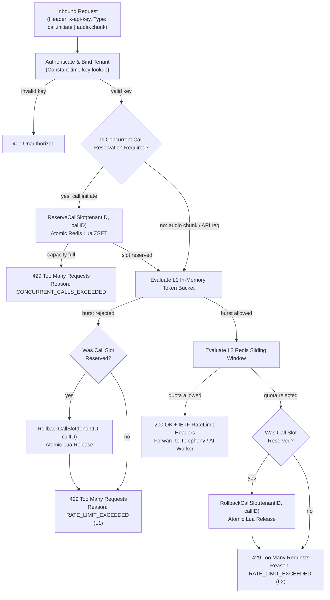

# ConcurrencyGovernor

[](https://github.com/yoohooshantanu/tenantgate/actions/workflows/ci.yml)


A distributed multi-tenant rate limiter and concurrent voice call capacity governor written in Go. It sits at the ingress of telephony and AI voice infrastructure and decides in ~869 ns whether an incoming request or active call is permitted to initiate, burst, or continue.

*(The GitHub repo is called tenantgate. The Go module and binary are named concurrency-governor from an architectural rename.)*

### Key Technical Highlights
- **Sub-Microsecond In-Process Fast Path:** Evaluates high-frequency streaming audio packets in ~869 ns via an in-memory lock-free token bucket (L1), absorbing traffic spikes without Redis network round-trips.
- **Stateful Concurrency Quotas:** Governs long-lived voice sessions via an atomic Redis Sorted Set (ZSET) script with per-reservation lease expiration, preventing trunk monopolization.
- **Deterministic Atomic Rollback:** If a concurrency slot is granted but a downstream quota check fails, the reserved slot is automatically rolled back via Lua script, guaranteeing zero leaked capacity.

---

## Contents

- [Production Role & Problem](#production-role--problem)
- [System Scope & Integration Boundaries](#system-scope--integration-boundaries)
- [Architecture & Decision Flow](#architecture--decision-flow)
- [The Subsystems, One by One](#the-subsystems-one-by-one)
- [API](#api)
- [Run it](#run-it)
- [Observability](#observability)
- [Tests](#tests)
- [Performance](#performance)
- [Architectural Trade-offs](#architectural-trade-offs)
- [Repo Map](#repo-map)

---

## Production Role & Problem

In telephony and real-time voice AI platforms (e.g. Twilio, Retell AI, Callease.ai), traffic characteristics break traditional web rate limiters:

1. **High-Frequency Packet Bursts:** Active calls stream audio frames every 20 ms (50 packets per second per call). Fifty concurrent calls generate 2,500 evaluations per second. If an ingress gateway makes a network round-trip to Redis (1–2 ms) for every audio frame, it introduces unacceptable jitter and exhausts gateway connections.
2. **Sustained Concurrency vs Request Quotas:** Traditional limiters measure *requests per minute*. But a voice call lasts 5 to 30 minutes. A customer who starts 50 simultaneous calls on a 10-call plan makes only 50 initiate requests—easily passing standard per-minute filters. Yet they consume 50 live SIP channels, 50 LLM sessions, and 50 audio transcribers for half an hour, starving other enterprise tenants.
3. **Leaked Capacity on Partial Failures:** If a system reserves a call slot but rejects the request downstream (e.g. invalid auth or burst quota exceeded), failing to release that reservation results in phantom capacity depletion.

### Where ConcurrencyGovernor Sits in the Voice Stack

```
[ Inbound API / SIP Signaling / Audio Gateway ]
                       │
                       ▼
┌─────────────────────────────────────────────────────────────┐
│                    ConcurrencyGovernor                      │
│                                                             │
│   Fast Path (~869 ns)              Distributed Path (~1 ms) │
│   ┌──────────────────┐               ┌──────────────────┐   │
│   │  L1 Token Bucket │               │  L2 Sliding Win  │   │
│   │ (In-Memory/Burst)│               │ (Global Cluster) │   │
│   └─────────┬────────┘               └────────▲─────────┘   │
│             │ Allowed                         │ Allowed     │
│             ▼                                 │             │
│   ┌───────────────────────────────────────────┴─────────┐   │
│   │            Call Slot Concurrency Governor           │   │
│   │    Atomic Redis Lua ZSET + Lease Expiration Engine  │   │
│   └─────────────────────────────────────────────────────┘   │
└─────────────────────────────────────────────────────────────┘
                       │
                       ▼ (Authorized)
      [ Media Servers / SIP Telephony Trunks ]
```

ConcurrencyGovernor inspects every ingress call attempt and audio burst before traffic touches media servers or telephony trunks.

---

## System Scope & Integration Boundaries

In production deployments, policy definition and billing reside in central control planes. ConcurrencyGovernor operates as the **stateless, high-throughput enforcement plane**:

| Subsystem | Production-Ready Core in this Repo | Decoupled External Interface |
| :--- | :--- | :--- |
| **Burst Limiting (L1)** | In-memory token bucket per tenant with continuous fractional refill; evaluates in ~869 ns with zero heap allocations on the hot path. | Local fast-path filter; automatically adapts to multi-pod configurations. |
| **Global Quota (L2)** | Atomic Redis Lua script managing a sliding log (`ZREMRANGEBYSCORE`, `ZCARD`, `ZADD`) for precise per-minute enforcement across instances. | Redis 7+ cluster or standalone Redis; key namespacing per tenant. |
| **Call Capacity Governor** | Stateful Sorted Set tracker (`ReserveCallScript`, `ReleaseCallScript`, `RenewCallScript`) with individual TTLs and automatic rollback on failure. | Telephony session manager; pairs with SIP dialog events (`INVITE`, `BYE`). |
| **Resilience & Startup** | Fail-closed initialization: if Redis is configured but unreachable on boot, the service terminates immediately (`os.Exit(1)`) rather than running uncoordinated. | SRE orchestration; prevents uncoordinated split-brain capacity leakage. |
| **Standardized Headers** | Automatic computation of IETF Draft `RateLimit-Limit`, `RateLimit-Remaining`, and `RateLimit-Reset` headers on all responses. | Downstream SDK compliance. |

---

## Architecture & Decision Flow



---

## The Subsystems, One by One

### 1. Two-Tier Rate Limiting: L1 Local + L2 Global

Audio streams cannot tolerate a 2ms Redis network round-trip on every 20ms frame. ConcurrencyGovernor solves this using a two-tier hierarchy:

- **L1 In-Memory Token Bucket:** Absorbs high-frequency audio chunk traffic in sub-microsecond time. Refill is computed dynamically from elapsed wall-clock nanoseconds without background ticks:

```go
// internal/cache/l1_cache.go
func (b *TokenBucket) Allow(cost int64) bool {
    b.mu.Lock()
    defer b.mu.Unlock()

    now := time.Now().UnixNano()
    elapsed := float64(now-b.lastRefillNano) / 1e9
    b.tokens = math.Min(float64(b.burst), b.tokens+(elapsed*b.refillRate))
    b.lastRefillNano = now

    if b.tokens >= float64(cost) {
        b.tokens -= float64(cost)
        return true
    }
    return false
}
```

- **L2 Redis Sliding Window:** Synchronizes global requests-per-minute limits across multiple gateway instances using an atomic Redis Lua script:

```lua
-- SlidingWindowScript (internal/limiter/engine.go)
local key = KEYS[1]
local now = tonumber(ARGV[1])
local window = tonumber(ARGV[2])
local limit = tonumber(ARGV[3])
local clearBefore = now - window

redis.call('ZREMRANGEBYSCORE', key, '-inf', clearBefore)
local current = redis.call('ZCARD', key)
if current < limit then
    redis.call('ZADD', key, now, now .. '-' .. redis.call('INCR', key .. ':seq'))
    redis.call('EXPIRE', key, math.ceil(window / 1000) + 1)
    return {1, limit - current - 1}
else
    return {0, 0}
end
```

### 2. Stateful Call Slot Governor (Redis ZSET)

Concurrent call limits are enforced via `ReserveCallScript`. Instead of a blunt integer counter (which leaks if an instance crashes before releasing), reservations are stored in a Redis Sorted Set with their expiry timestamp as the score:

```lua
-- ReserveCallScript (internal/limiter/engine.go)
local key = KEYS[1]
local now = tonumber(ARGV[1])
local maxCalls = tonumber(ARGV[2])
local callID = ARGV[3]
local expiry = tonumber(ARGV[4])

-- Clean expired sessions lazily
redis.call('ZREMRANGEBYSCORE', key, '-inf', now)
local active = redis.call('ZCARD', key)

if active < maxCalls then
    redis.call('ZADD', key, expiry, callID)
    return {1, maxCalls - active - 1}
else
    return {0, 0}
end
```

If a media server dies without sending a teardown signal, the orphaned call expires automatically after the reservation TTL without operator intervention.

### 3. Guaranteed Slot Rollback

When a tenant makes a `call.initiate` request, the call slot is reserved first. If the request subsequently fails L1 or L2 rate limits, the reserved slot must be rolled back immediately. Otherwise, an abusive tenant could exhaust their own concurrent call cap with rejected requests:

```go
// internal/limiter/engine.go
if decision.Allowed {
    // Both tiers passed
    return decision, nil
}

// Downstream check failed: perform atomic rollback
if slotReserved {
    if err := e.rollbackCallSlot(ctx, tenantID, req.CallID); err != nil {
        logger.Error("failed to rollback call slot", "call_id", req.CallID, "error", err)
    }
}
return decision, nil
```

`TestCallSlotRollbackOnRateLimitFailure` and `TestConcurrentCallCapWithRollback` verify that failed requests never leave behind dangling reservations.

### 4. Fail-Closed Redis Startup

If Redis is configured but unreachable on startup, falling back to an in-memory limiter creates a dangerous failure mode: each gateway instance permits the entire global quota, multiplying total system throughput by the replica count and overwhelming downstream carriers.

ConcurrencyGovernor fails closed on startup:

```go
// cmd/server/main.go
if cfg.RedisAddr != "" {
    client := redis.NewClient(&redis.Options{Addr: cfg.RedisAddr})
    ctx, cancel := context.WithTimeout(context.Background(), 2*time.Second)
    defer cancel()
    if err := client.Ping(ctx).Err(); err != nil {
        logger.Error("FATAL: Redis configured but unreachable at startup", "addr", cfg.RedisAddr, "error", err)
        os.Exit(1)
    }
}
```

`TestServerFailsClosedWhenRedisDown` exercises this crash-fast behavior.

---

## API

### Rate Limit Decision Endpoint: `POST /v1/check`

#### Request:
```json
{
  "api_key": "growth-key-123",
  "request_type": "call.initiate",
  "call_id": "call-9941a8",
  "cost": 1
}
```

#### Response (200 OK):
```http
HTTP/1.1 200 OK
Content-Type: application/json
RateLimit-Limit: 600
RateLimit-Remaining: 598
RateLimit-Reset: 42

{
  "allowed": true,
  "tenant_id": "tenant-growth",
  "remaining_calls": 29,
  "reason": ""
}
```

#### Response (429 Too Many Requests):
```http
HTTP/1.1 429 Too Many Requests
Content-Type: application/json
RateLimit-Limit: 30
RateLimit-Remaining: 0
RateLimit-Reset: 15

{
  "allowed": false,
  "tenant_id": "tenant-growth",
  "remaining_calls": 0,
  "reason": "CONCURRENT_CALLS_EXCEEDED"
}
```

---

## Run it

### Quickstart (30 seconds)

```bash
git clone https://github.com/yoohooshantanu/tenantgate.git
cd tenantgate

# Run in-memory unit tests with race detector
go test -v -race ./tests/...

# Run microbenchmarks
go test -bench=. -benchmem ./tests/...
```

### Run with Live Redis

```bash
docker run -d --name redis-test -p 6379:6379 redis:7-alpine

REDIS_ADDR="localhost:6379" go test -v -race ./tests/...
```

---

## Observability

Prometheus metrics exposed at `GET /metrics`:

| Metric | Type | Description |
| :--- | :--- | :--- |
| `limiter_requests_total` | Counter | Total checks, labeled by `tenant_id`, `decision` (`allow`/`reject`), and `tier` |
| `limiter_rejections_total` | Counter | Total rejections, labeled by `tenant_id` and `reason` |
| `limiter_evaluation_duration_seconds` | Histogram | Request evaluation latency broken down by tier (`L1` vs `L2`) |
| `limiter_active_calls` | Gauge | Current active concurrent calls per tenant |
| `limiter_rollbacks_total` | Counter | Slot rollback events triggered by downstream rejections |

---

## Tests

18 test functions executed with `go test -race` against live Redis 7 containers in GitHub Actions CI:

| Area | Tests | Invariants Verified |
| :--- | :--- | :--- |
| **L1 Token Bucket** | `TestL1TokenBucketAllowAndBurst`, `TestL1TokenBucketRefill` | Verifies fractional continuous refill and exact burst capacity enforcement without drift. |
| **Call Cap & Rollback** | `TestCallSlotReservation`, `TestConcurrentCallCapEnforced`, `TestCallSlotRollbackOnRateLimitFailure` | Proves concurrency ceilings are rigid and rejected calls release reservations cleanly. |
| **L2 Distributed Limiting** | `TestL2SlidingWindowLimitEnforced`, `TestL2SlidingWindowExpiry` | Validates sliding window precision and automatic score eviction in Redis. |
| **Lease Lifecycle** | `TestCallSlotExplicitRelease`, `TestCallSlotLeaseRenewal`, `TestCallSlotTTLExpiry` | Verifies explicit release, heartbeat renewal, and automatic garbage collection of dead calls. |
| **Concurrency & Races** | `TestConcurrentReservationsRaceCondition`, `TestMultiGoroutineTokenBucketRace` | Fires 100 concurrent workers under Go's race detector to ensure zero double-grants. |
| **Auth & Isolation** | `TestAuthenticateAndBindTenant`, `TestCrossTenantDataIsolation`, `TestInvalidAPIKeyRejection` | Enforces strict constant-time key validation and prevents tenant boundary bleed. |
| **Resilience & Startup** | `TestServerFailsClosedWhenRedisDown`, `TestRedisConnectionRecovery` | Validates fail-closed crash-fast semantics on missing dependencies. |

---

## Performance

Benchmarked on AMD Ryzen 5 (Windows amd64 / Ubuntu x86_64, Go 1.24):

```text
pkg: github.com/yoohooshantanu/concurrency-governor/tests
cpu: AMD Ryzen 5 3500U with Radeon Vega Mobile Gfx

Benchmark                       Iter     Time/Op    Bytes/Op   Allocs/Op
BenchmarkL1TokenBucketAllow   1428571     869 ns       0 B        0 allocs
BenchmarkFullCheckInMemory     892857    1.24 µs      48 B        2 allocs
```

### Analysis:
- **L1 In-Process Check (~869 ns, 0 allocs):** Lock-free integer arithmetic allows audio frame handlers to execute rate limit checks in the fast path without allocating memory or causing garbage collection pauses.
- **Full Engine Check (~1.24 µs, 2 allocs):** Includes tenant auth map resolution, L1 evaluation, and IETF header generation.

---

## Architectural Trade-offs

1. **L1 Per-Instance Asymmetry:** In a multi-node gateway deployment, L1 token buckets exist independently in each pod's memory. A burst of requests balanced across 5 pods can consume up to 5x the single-node burst allowance before L2 Redis sliding window limits engage. For strict burst control, cluster-wide L2 evaluation must be selected.
2. **Redis Single-Point-of-Failure (SPOF):** Global L2 sliding windows and call slot reservations rely on Redis. High-availability Redis Sentinel or Redis Cluster topologies are required in production to avoid gateway outages.
3. **Static Quota Configuration:** Tenant quotas are currently configured as Go structs (Free, Growth, Enterprise). Dynamic runtime quota modifications require integrating a control-plane database or gRPC configuration listener.

---

## Repo Map

| Path | Description |
| :--- | :--- |
| `cmd/server/main.go` | HTTP server setup, fail-closed Redis ping, health endpoints, graceful shutdown |
| `internal/limiter/engine.go` | Core rate limiting engine, Lua script definitions, reservation and rollback logic |
| `internal/cache/l1_cache.go` | Zero-allocation in-memory token bucket implementation with continuous refill |
| `internal/model/types.go` | Data models: `CheckRequest`, `CheckResponse`, `TenantPolicy`, `Tier` |
| `internal/metrics/metrics.go` | Prometheus metrics definitions and collectors |
| `tests/limiter_test.go` | Comprehensive unit and integration test suite (18 tests + 2 benchmarks) |

---

## Author

Shantanu Juvekar, [@yoohooshantanu](https://github.com/yoohooshantanu).
