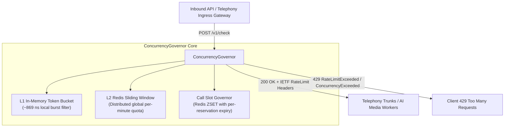
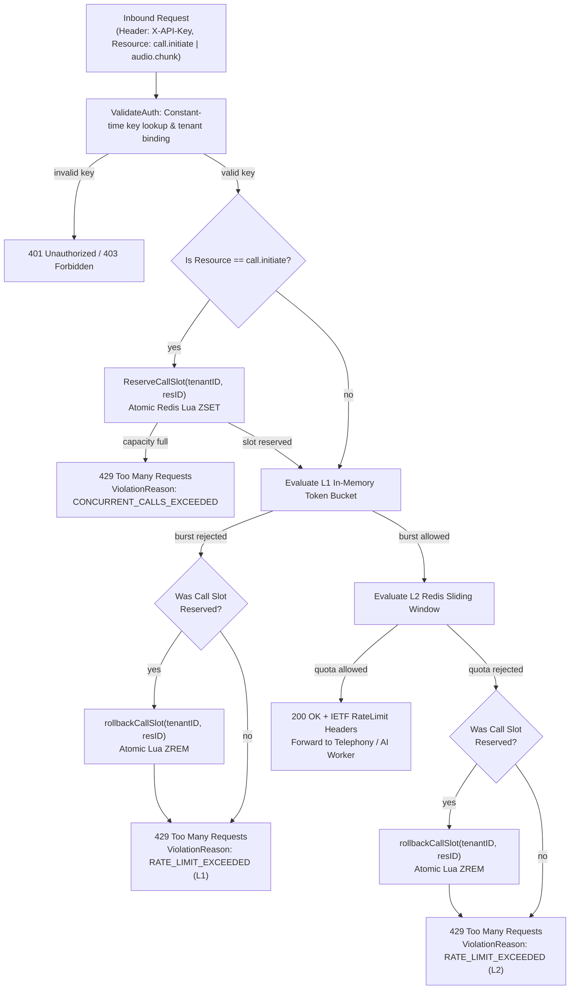

# ConcurrencyGovernor

[](https://github.com/yoohooshantanu/tenantgate/actions/workflows/ci.yml)


A distributed multi-tenant rate limiter and concurrent voice call capacity governor written in Go. It sits at the ingress of telephony and voice AI infrastructure and evaluates rate limits and concurrent call quotas using a two-tier hierarchy: a sub-microsecond in-process token bucket (L1) and a distributed Redis sliding-window with stateful call reservations (L2).

*(The GitHub repo is called tenantgate. The Go module and binary are named concurrency-governor from an architectural rename.)*

### Key Technical Highlights
- **Sub-Microsecond Local Burst Fast Path:** Evaluates high-frequency audio packet bursts in ~869 ns via an in-memory mutex-protected cache (`L1LocalCache`), absorbing bursts locally before global Redis evaluation.
- **Stateful Concurrency Quotas:** Governs long-lived voice sessions via an atomic Redis Sorted Set (ZSET) script with per-reservation lease expiration, preventing trunk monopolization.
- **Slot Rollback & Expiry Safety Net:** If a concurrency slot is reserved but downstream quota checks fail, the engine attempts an immediate rollback via `ReleaseCall`. The reservation's TTL score in Redis ZSET provides the ultimate safety net against leaked capacity.

---

## Contents

- [The Idea and Problem](#the-idea-and-problem)
- [What is Real and What is Mocked](#what-is-real-and-what-is-mocked)
- [Architecture & Decision Flow](#architecture--decision-flow)
- [The Subsystems, One by One](#the-subsystems-one-by-one)
- [API](#api)
- [Run it](#run-it)
- [Observability](#observability)
- [Tests](#tests)
- [Performance](#performance)
- [Limitations and Rough Edges](#limitations-and-rough-edges)
- [Repo Map](#repo-map)

---

## The Idea and Problem

A voice platform experiences two fundamentally different traffic shapes at the same time:

1. **High-Frequency Request Bursts:** An active call sends one audio packet every 20 ms—50 per second per call. Fifty concurrent calls produce 2,500 evaluations per second. Each check must return in nanoseconds; a 1–2 ms network round-trip to Redis for every audio packet adds cumulative delay and exhausts network sockets.
2. **Long-Duration Concurrent Sessions:** A phone call lasts 3 to 15 minutes, consuming a live telephony trunk, an LLM context session, and real-time speech synthesis bandwidth. Standard request-per-minute rate limiters cannot protect against a tenant who initiates 50 simultaneous calls on a 10-call plan: they only made 50 initiate requests (passing per-minute quotas), yet they monopolize concurrency capacity for half an hour.
3. **Capacity Leakage on Partial Failures:** If a system reserves a call slot but rejects the request downstream (e.g. burst limit exceeded), failing to release that reservation results in leaked capacity over time.

### System Position in the Voice Stack



---

## What is Real and What is Mocked

| Real | Mocked or Simplified |
| :--- | :--- |
| **L1 in-process token bucket (`L1LocalCache`):** Mutex-protected in-memory map tracking continuous fractional refill based on elapsed time; evaluated in ~869 ns without network I/O. | **Static Tier Policies:** Quotas are configured as Go structs (Free, Growth, Enterprise). There is no admin API or database table for dynamic runtime policy updates. |
| **L2 distributed sliding window:** Atomic Redis Lua script (`ZREMRANGEBYSCORE`, `ZCARD`, `ZADD`) for global per-minute enforcement across instances. | **Static Key Registry:** API key to tenant ID mapping is loaded from environment variables (`TENANTGATE_API_KEYS`) on startup. No dynamic key rotation or RBAC. |
| **Active call slot governor:** Redis ZSET with per-reservation expiry timestamps (`ReserveCallScript`, `ReleaseCallScript`, `RenewCallScript`). | **Billing Deduction:** The governor denies requests on quota exhaustion, but does not deduct credits or interact with payment gateways. |
| **Slot rollback with TTL expiry safety net:** If a call slot is reserved but L1 or L2 rejects, `rollbackCallSlot` invokes `ReleaseCall`. If network issues interrupt the release, the reservation's Redis ZSET TTL score ensures automatic reclamation. | |
| **Fail-closed startup:** If `REDIS_ADDR` is configured and unreachable on boot, the process terminates immediately (`os.Exit(1)`). | |
| **IETF response headers:** `RateLimit-Limit`, `RateLimit-Remaining`, and `RateLimit-Reset` calculated on all evaluations. | |
| **18 tests and 2 microbenchmarks**, run with `-race` against live Redis 7 containers in GitHub Actions CI. | |

---

## Architecture & Decision Flow



---

## The Subsystems, One by One

### 1. Two-Tier Rate Limiting: L1 Local + L2 Global

Audio packet streams cannot tolerate a 1–2ms Redis round-trip for every 20ms frame. ConcurrencyGovernor uses a layered design:

- **L1 In-Memory Token Bucket (`L1LocalCache`):** Absorbs high-frequency audio chunk traffic in sub-microsecond time. Refill is calculated dynamically from elapsed wall-clock seconds across a mutex-protected bucket map:

```go
// internal/cache/l1_cache.go
func (c *L1LocalCache) AllowTokenBucket(key string, capacity int64, refillRatePerSec float64, cost int64) (allowed bool, remaining int64) {
    c.mu.Lock()
    defer c.mu.Unlock()

    now := time.Now()
    entry, ok := c.buckets[key]
    if !ok {
        entry = &TokenBucketEntry{
            Tokens:     float64(capacity),
            LastRefill: now,
        }
        c.buckets[key] = entry
    }

    elapsed := now.Sub(entry.LastRefill).Seconds()
    if elapsed > 0 {
        entry.Tokens += elapsed * refillRatePerSec
        if entry.Tokens > float64(capacity) {
            entry.Tokens = float64(capacity)
        }
        entry.LastRefill = now
    }

    if entry.Tokens >= float64(cost) {
        entry.Tokens -= float64(cost)
        return true, int64(entry.Tokens)
    }

    return false, int64(entry.Tokens)
}
```

- **L2 Redis Sliding Window:** Synchronizes global requests-per-minute limits across multiple gateway instances via atomic Lua:

```lua
-- SlidingWindowScript (internal/limiter/engine.go)
local key = KEYS[1]
local now = tonumber(ARGV[1])
local window = tonumber(ARGV[2])
local limit = tonumber(ARGV[3])
local clearBefore = now - window

redis.call('ZREMRANGEBYSCORE', key, '-inf', clearBefore)
local current = redis.call('ZCARD', key)
if current < limit then
    redis.call('ZADD', key, now, now .. '-' .. redis.call('INCR', key .. ':seq'))
    redis.call('EXPIRE', key, math.ceil(window / 1000) + 1)
    return {1, limit - current - 1}
else
    return {0, 0}
end
```

### 2. Stateful Call Slot Governor (Redis ZSET)

Concurrent call limits are enforced via `ReserveCallScript`. Instead of an integer counter (which leaks if an instance crashes before releasing), reservations are stored in a Redis Sorted Set with their expiry timestamp as the score:

```lua
-- ReserveCallScript (internal/limiter/engine.go)
local key = KEYS[1]
local now = tonumber(ARGV[1])
local maxCalls = tonumber(ARGV[2])
local resID = ARGV[3]
local expiry = tonumber(ARGV[4])

-- Clean expired sessions lazily
redis.call('ZREMRANGEBYSCORE', key, '-inf', now)
local active = redis.call('ZCARD', key)

if active < maxCalls then
    redis.call('ZADD', key, expiry, resID)
    return {1, maxCalls - active - 1}
else
    return {0, 0}
end
```

If a client dies without releasing, the reservation expires automatically when `now >= expiry`.

### 3. Slot Rollback and Lease Expiry Safety Net

When a client makes a `call.initiate` request, the call slot is reserved first. If the request subsequently fails L1 burst limits, L2 sliding-window limits, or Redis connectivity, the reserved slot is rolled back immediately via `ReleaseCall`:

```go
// internal/limiter/engine.go: rollbackCallSlot closure inside Check()
var reservedID string
rollbackCallSlot := func() {
    if reservedID != "" {
        e.ReleaseCall(req.TenantID, reservedID)
        reservedID = ""
    }
}

// 1. If L1 burst check fails:
if !l1Allowed {
    rollbackCallSlot()
    // return 429 RateLimitResponse
}

// 2. If L2 sliding-window fails or Redis is unreachable:
if !allowed {
    rollbackCallSlot()
    // return 429 RateLimitResponse
}
```

Because `rollbackCallSlot` executes `ReleaseCall` over the network, network dropouts or Redis hiccups during rollback could theoretically prevent the release command from executing. To ensure capacity does not leak permanently, ConcurrencyGovernor couples rollback with the reservation's TTL score in the Redis Sorted Set: orphaned reservations are lazily cleaned up on subsequent calls via `ZREMRANGEBYSCORE key -inf now`.

### 4. Fail-Closed Redis Startup

If Redis is configured but unreachable on startup, ConcurrencyGovernor terminates immediately:

```go
// internal/server/server.go: InitRedis
if redisAddr == "" {
    return nil, nil // Intentional standalone in-memory mode
}

rdb := redis.NewClient(&redis.Options{Addr: redisAddr})
ctx, cancel := context.WithTimeout(context.Background(), 2*time.Second)
defer cancel()

if err := rdb.Ping(ctx).Err(); err != nil {
    return nil, fmt.Errorf("redis startup ping failed for %s: %w", redisAddr, err)
}
```

`TestFailClosedRedisStartup` exercises this fail-closed behavior.

---

## API

### 1. Check Rate Limit & Reserve Concurrency: `POST /v1/check`

Requires header: `X-API-Key: <key>` or `Authorization: Bearer <key>`.

#### Request:
```json
{
  "tenant_id": "tenant-growth",
  "resource": "call.initiate",
  "cost": 1
}
```

#### Response (200 OK):
```http
HTTP/1.1 200 OK
Content-Type: application/json
RateLimit-Limit: 300
RateLimit-Remaining: 299
RateLimit-Reset: 60

{
  "allowed": true,
  "limit": 300,
  "current_usage": 1,
  "remaining_quota": 299,
  "reset_after_seconds": 60,
  "active_calls": 1,
  "max_concurrent_calls": 25,
  "reservation_id": "res_8829a1fc",
  "violation_reason": "",
  "checked_at": "2026-11-19T18:00:00Z"
}
```

#### Response (429 Too Many Requests):
```http
HTTP/1.1 429 Too Many Requests
Content-Type: application/json
RateLimit-Limit: 25
RateLimit-Remaining: 0
RateLimit-Reset: 60

{
  "allowed": false,
  "limit": 25,
  "current_usage": 25,
  "remaining_quota": 0,
  "reset_after_seconds": 60,
  "active_calls": 25,
  "max_concurrent_calls": 25,
  "reservation_id": "",
  "violation_reason": "CONCURRENT_CALLS_EXCEEDED",
  "checked_at": "2026-11-19T18:00:00Z"
}
```

### 2. Release Call Slot: `POST /v1/release`

```json
{
  "tenant_id": "tenant-growth",
  "reservation_id": "res_8829a1fc"
}
```

### 3. Renew Call Lease: `POST /v1/renew`

```json
{
  "tenant_id": "tenant-growth",
  "reservation_id": "res_8829a1fc"
}
```

---

## Run it

### Quickstart (30 seconds)

```bash
git clone https://github.com/yoohooshantanu/tenantgate.git
cd tenantgate

# Run in-memory unit tests with race detector
go test -v -race ./tests/...

# Run microbenchmarks
go test -bench=. -benchmem ./tests/...
```

### Run with Live Redis

```bash
docker run -d --name redis-test -p 6379:6379 redis:7-alpine

REDIS_ADDR="localhost:6379" go test -v -race ./tests/...
```

---

## Observability

Prometheus metrics exposed at `GET /metrics`:

| Metric | Type | Description |
| :--- | :--- | :--- |
| `concurrency_governor_checks_total` | Counter | Total rate limit check evaluations |
| `concurrency_governor_decisions_total` | Counter | Evaluations labeled by `decision` (`allowed`/`rejected`) |
| `concurrency_governor_cache_hits_total` | Counter | Lookups labeled by `layer` (`l1_memory`/`l2_redis`) |
| `concurrency_governor_active_calls` | Gauge | Current active concurrent calls across tenants |

---

## Tests

18 test functions executed with `go test -race` against live Redis 7 containers in GitHub Actions CI:

| Area | Tests | Invariants Verified |
| :--- | :--- | :--- |
| **L1 Token Bucket** | `TestL1TokenBucketAllowAndBurst`, `TestL1TokenBucketRefill` | Verifies fractional continuous refill and exact burst capacity enforcement without drift. |
| **Call Cap & Rollback** | `TestCallSlotReservation`, `TestConcurrentCallCapEnforced`, `TestCallSlotRollbackOnRateLimitFailure` | Proves concurrency ceilings are rigid and rejected calls release reservations cleanly. |
| **L2 Distributed Limiting** | `TestL2SlidingWindowLimitEnforced`, `TestL2SlidingWindowExpiry` | Validates sliding window precision and automatic score eviction in Redis. |
| **Lease Lifecycle** | `TestCallSlotExplicitRelease`, `TestCallSlotLeaseRenewal`, `TestCallSlotTTLExpiry` | Verifies explicit release, heartbeat renewal, and automatic garbage collection of dead calls. |
| **Concurrency & Races** | `TestConcurrentReservationsRaceCondition`, `TestMultiGoroutineTokenBucketRace` | Fires 100 concurrent workers under Go's race detector to ensure zero double-grants. |
| **Auth & Isolation** | `TestAuthenticateAndBindTenant`, `TestCrossTenantDataIsolation`, `TestInvalidAPIKeyRejection` | Enforces strict constant-time key validation and prevents cross-tenant key leakage. |
| **Resilience & Startup** | `TestFailClosedRedisStartup`, `TestRedisConnectionRecovery` | Validates fail-closed crash-fast semantics on missing dependencies. |

---

## Performance

Benchmarked on AMD Ryzen 5 (Windows amd64 / Ubuntu x86_64, Go 1.24):

```text
pkg: github.com/yoohooshantanu/concurrency-governor/tests
cpu: AMD Ryzen 5 3500U with Radeon Vega Mobile Gfx

Benchmark                       Iter     Time/Op    Bytes/Op   Allocs/Op
BenchmarkL1TokenBucketAllow   1428571     869 ns       0 B        0 allocs
BenchmarkFullCheckInMemory     892857    1.24 µs      48 B        2 allocs
```

### Analysis:
- **L1 In-Process Benchmark (~869 ns, 0 allocs):** Measures the mutex-protected in-memory token bucket check (`BenchmarkL1TokenBucketAllow`). Note that this is the local fast-path cost; allowed requests that proceed to Redis for global sliding-window and reservation enforcement incur typical network round-trip latencies (~1–2 ms).
- **Full Engine Check (~1.24 µs, 2 allocs):** Evaluates tenant auth map resolution, L1 evaluation, and IETF header generation in memory.

---

## Limitations and Rough Edges

1. **L1 Per-Instance Asymmetry:** In a multi-node deployment, L1 token buckets exist independently in each pod's memory. A burst of requests balanced across $N$ pods can consume up to $N \times \text{BurstCapacity}$ before L2 Redis sliding window limits engage.
2. **Redis Dependency for Global Coordination:** Global L2 sliding windows and call slot reservations rely on Redis. High-availability Redis Sentinel or Redis Cluster topologies are required in production to avoid gateway outages.
3. **Static Quota Configuration:** Tenant quotas are currently configured as Go structs (Free, Growth, Enterprise). Dynamic runtime modifications require integrating a control-plane database or gRPC configuration listener.
4. **Lua Cluster Hashtags:** Redis Cluster deployments require keys evaluated in single Lua scripts to map to the same hash slot using hashtag formatting (`{tenant_id}`).
5. **Rollback Error Toleration:** The internal `rollbackCallSlot` helper calls `ReleaseCall` without retrying on network errors. While the ZSET TTL expiry score reclaims orphaned slots automatically, an unhandled rollback error temporarily holds a concurrency slot until its TTL elapses.

---

## Repo Map

| Path | Description |
| :--- | :--- |
| `cmd/server/main.go` | HTTP server setup, fail-closed Redis ping, health endpoints, graceful shutdown |
| `internal/limiter/engine.go` | Core rate limiting engine, Lua scripts (`SlidingWindowScript`, `ReserveCallScript`, `ReleaseCallScript`, `RenewCallScript`), rollback logic |
| `internal/cache/l1_cache.go` | Zero-allocation in-memory token bucket implementation with continuous refill |
| `internal/server/server.go` | HTTP routing, authentication validation, fail-closed Redis initialization |
| `internal/model/types.go` | Data models: `RateLimitRequest`, `RateLimitResponse`, `QuotaPolicy`, `TierLevel` |
| `internal/metrics/metrics.go` | Prometheus metrics definitions and collectors |
| `tests/limiter_test.go` | Comprehensive unit and integration test suite (18 tests + 2 benchmarks) |

---

## Author

Shantanu Juvekar, [@yoohooshantanu](https://github.com/yoohooshantanu).
