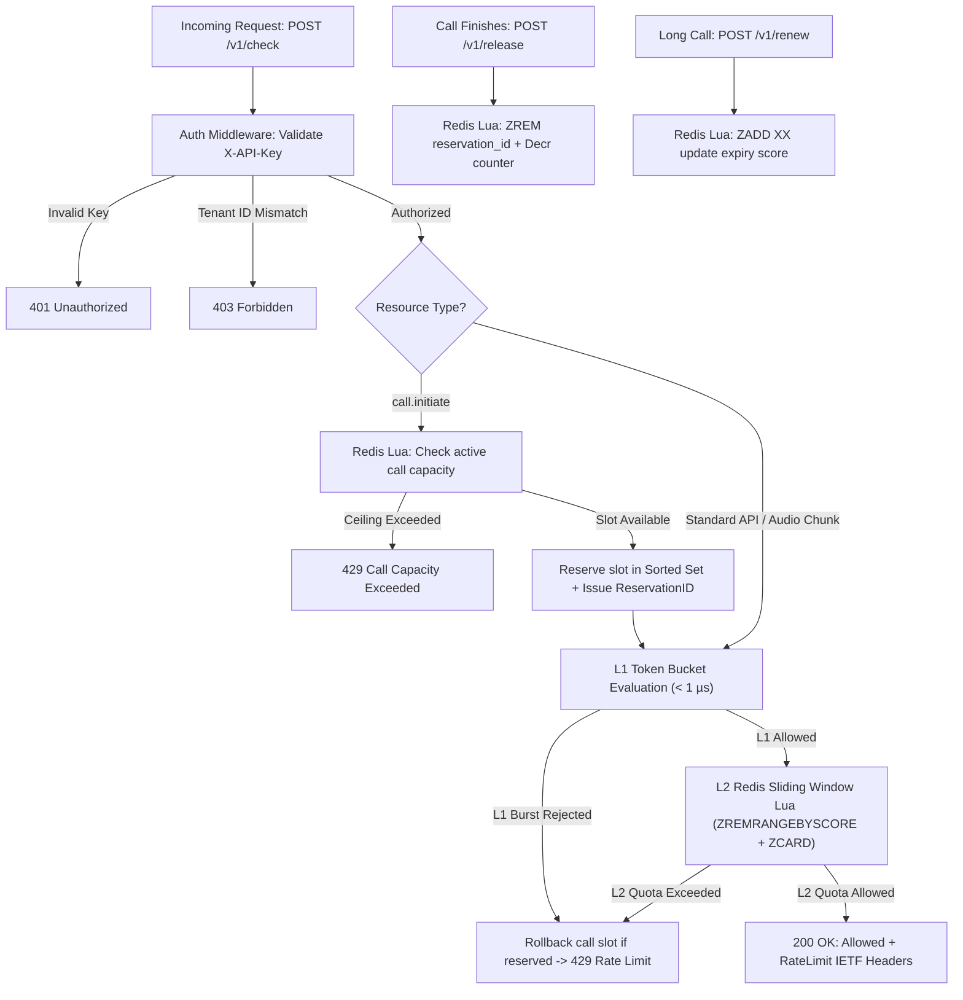

# ConcurrencyGovernor

[](https://github.com/yoohooshantanu/tenantgate/actions/workflows/ci.yml)
[](https://go.dev/)
[](https://redis.io/)
[](https://tools.ietf.org/html/draft-ietf-httpapi-ratelimit-headers)

A low-latency distributed multi-tenant rate limiter and concurrent voice call capacity governor written in Go. Sitting at the edge of telephony and AI voice infrastructure, it protects LLM backends from abuse, isolates noisy neighbors, enforces per-tenant concurrent call ceilings, and prevents credit exhaustion using a two-tier architecture: sub-microsecond in-memory token buckets (L1) and cluster-wide sliding windows in Redis via atomic Lua scripts (L2).

I wanted to build the gatekeeper that keeps a voice AI platform solvent: the system that decides within a microsecond whether a caller gets through, whether a tenant has exceeded their active call limit, and what happens when five thousand audio frames hit the gateway at once.

*(The GitHub repo is called tenantgate. The Go module and binary are named concurrency-governor from a later rename.)*

## Contents

- [The idea in two minutes](#the-idea-in-two-minutes)
- [What is real and what is mocked](#what-is-real-and-what-is-mocked)
- [Rate limiting & reservation flow](#rate-limiting--reservation-flow)
- [The pieces, one by one](#the-pieces-one-by-one)
- [API specification](#api-specification)
- [Run it](#run-it)
- [Observability](#observability)
- [Tests](#tests)
- [Performance](#performance)
- [Limitations and rough edges](#limitations-and-rough-edges)
- [Repo map](#repo-map)
- [Author](#author)

---

## The idea in two minutes

Standard web rate limiters count requests per second. If an API client makes 100 requests in a minute, they get throttled.

Voice AI infrastructure cannot rely on request counting alone. A voice platform has two distinct dimensions of load:
1. **High-frequency request bursts**: Audio chunks arrive every 20ms (50 packets per second per active call). A fleet of calls generates thousands of requests per second that must be evaluated with sub-microsecond latency without burning Redis network round-trips.
2. **Concurrent active sessions**: An ongoing phone call lasts 3 to 15 minutes. During that entire time, the call consumes an expensive telephony trunk, an LLM context session, and real-time TTS bandwidth. If a tenant on a 10-call tier spins up 50 calls simultaneously, counting requests per second will not stop them from bankrupting your cloud bill.

ConcurrencyGovernor solves both problems in a unified edge service:
- **L1 In-Memory Token Bucket**: Absorbs audio chunk bursts locally in **~869 nanoseconds** without hitting the network.
- **L2 Redis Lua Sliding Window**: Enforces strict cluster-wide rate limits across distributed gateway nodes.
- **Active Call Capacity Governor**: Tracks stateful active call slots with atomic reservations, lease renewals, and automatic rollback on failure.

---

## What is real and what is mocked

| Real | Mocked or simplified |
| :--- | :--- |
| **Dual-tier rate limiting**: In-memory token bucket (<1 µs) backed by distributed Redis sorted-set sliding window scripts (`EVALSHA`). | **Tenant registry storage**: API keys and tier limits (Free, Growth, Enterprise) are loaded from static configuration or environment variables rather than a relational database. |
| **Active call reservation engine**: Atomic `call.initiate` slot reservations in Redis (`cc:res:<tenant>`) returning unique `ReservationID`s. | **Telephony carrier**: ConcurrencyGovernor does not place SIP calls; it sits in front of the dialer or audio gateway to approve or deny call creation. |
| **Per-reservation TTL & lease renewal**: 4-hour safety ceiling (`ZADD`) with `/v1/renew` (`ZADD XX`) prevents orphaned calls without blanket key expirations. | **Billing / Payment processing**: Denies traffic on quota exhaustion, but does not process credit cards or integrate with Stripe. |
| **Atomic rollback**: If downstream checks or L1 limits fail after reserving a call slot, the reservation is immediately refunded via Lua. | |
| **Fail-closed startup**: If `REDIS_ADDR` is configured but unreachable on boot, the service aborts (`os.Exit(1)`) rather than running uncoordinated. | |
| **IETF compliance**: Standard `RateLimit-Limit`, `RateLimit-Remaining`, and `RateLimit-Reset` HTTP headers on all responses. | |
| **Strict tenant isolation**: API keys are bound 1:1 to tenants. Cross-tenant access is rejected with `403 Forbidden`. | |
| **18 tests in CI**: Integration tests run against live Redis 7 with `-race` in GitHub Actions. | |

*Summary: This is a high-throughput edge governor and distributed concurrency coordinator, not a billing engine.*

---

## Rate limiting & reservation flow



---

## The pieces, one by one

### 1. Dual-tier rate limiting (L1 + L2)
- **L1 In-Memory Token Bucket**: Evaluated in-process with atomic lock-free counters. Designed for high-frequency telephony audio frames, it decisions requests in **~869 nanoseconds** without network latency.
- **L2 Distributed Sliding Window**: When global quotas must be synchronized across a cluster of gateway instances, requests execute an atomic Redis Lua script. It cleans expired timestamps via `ZREMRANGEBYSCORE`, checks current window volume with `ZCARD`, and records the new timestamp via `ZADD`.

### 2. Active call slot reservation & concurrency ceilings
When a client requests `resource: "call.initiate"`:
1. The engine checks the tenant's tier concurrency limit (e.g. Free: 5, Growth: 30, Enterprise: 300).
2. If capacity remains, it generates a unique `ReservationID` (e.g. `res_9f8c12a4`) and inserts it into the tenant's Redis Sorted Set (`cc:res:<tenant>`).
3. The response returns the reservation token, which the telephony worker holds for the duration of the call.

### 3. Per-reservation TTL and lease renewal (`/v1/renew`)
Other systems set a blanket Redis key TTL on the tenant's counter, which disastrously drops active call counts to zero every hour. 
ConcurrencyGovernor uses **individual reservation scoring**:
- The Sorted Set score is set to `now + DefaultReservationTTL` (4 hours / 14,400s). This acts as a garbage collection ceiling for crashed workers or lost network disconnects.
- Long-running calls renew their lease by calling `POST /v1/renew`. The renewal script executes `ZADD XX` (only update if element already exists), ensuring expired or non-existent reservations can never create phantom slots.

### 4. Idempotent slot release & automatic rollback
- **Release (`POST /v1/release`)**: When a call disconnects, the worker presents its `ReservationID`. The Lua script removes the member from the Sorted Set and updates the active count. Releasing an already-released reservation is an idempotent no-op.
- **Atomic Rollback**: If an incoming call passes the concurrent slot check but subsequently fails the L1 token bucket or downstream validation, ConcurrencyGovernor automatically releases the reserved slot before returning `429 Too Many Requests`.

### 5. Fail-closed startup
In cloud environments, a rate limiter that silently ignores a dead Redis cluster opens the floodgates to cascading backend outages. 
If `REDIS_ADDR` is provided but the initial `PING` probe fails, ConcurrencyGovernor refuses to start (`os.Exit(1)`). It refuses to run in uncoordinated standalone mode when configured for distributed coordination.

---

## API specification

### 1. Check rate limit or reserve call
`POST /v1/check`

```bash
curl -X POST http://localhost:8082/v1/check \
  -H "Content-Type: application/json" \
  -H "X-API-Key: tg_live_growth_key" \
  -d '{
    "tenant_id": "cust_enterprise_01",
    "resource": "call.initiate",
    "cost": 1
  }'
```

**Response (200 OK):**
```json
{
  "allowed": true,
  "remaining": 29,
  "reset_after_seconds": 60,
  "reservation_id": "res_a1b2c3d4e5f6",
  "resource": "call.initiate",
  "active_calls": 1
}
```

### 2. Renew active call lease
`POST /v1/renew`

```bash
curl -X POST http://localhost:8082/v1/renew \
  -H "Content-Type: application/json" \
  -H "X-API-Key: tg_live_growth_key" \
  -d '{
    "tenant_id": "cust_enterprise_01",
    "reservation_id": "res_a1b2c3d4e5f6",
    "ttl_seconds": 14400
  }'
```

### 3. Release call slot
`POST /v1/release`

```bash
curl -X POST http://localhost:8082/v1/release \
  -H "Content-Type: application/json" \
  -H "X-API-Key: tg_live_growth_key" \
  -d '{
    "tenant_id": "cust_enterprise_01",
    "reservation_id": "res_a1b2c3d4e5f6"
  }'
```

---

## Run it

### Environment variables

| Variable | Default | Description |
| :--- | :--- | :--- |
| `PORT` | `8082` | HTTP listen port |
| `REDIS_ADDR` | `""` | Redis connection address (e.g. `localhost:6379`) |
| `DEFAULT_TIER` | `free` | Default quota tier when unassigned (`free`, `growth`, `enterprise`) |

### Running locally

```bash
# Clone the repository
git clone https://github.com/yoohooshantanu/tenantgate.git
cd tenantgate

# Run unit and integration tests
go test -v ./tests/...

# Start service
go run ./cmd/server
```

### Running with Docker Compose

```bash
docker compose up -d
```

- **Governor Gateway**: `http://localhost:8082`
- **Prometheus Metrics**: `http://localhost:8082/metrics`
- **Health Check**: `http://localhost:8082/healthz`

---

## Observability

ConcurrencyGovernor exposes Prometheus metrics at `GET /metrics`:

| Metric | Type | Description |
| :--- | :--- | :--- |
| `rate_limit_checks_total` | Counter | Total rate limit evaluations, labeled by `tenant_id` and `status` (`allowed`, `denied`) |
| `active_concurrent_calls` | Gauge | Currently reserved active calls per tenant |
| `call_reservations_total` | Counter | Total call slots reserved, renewed, and released |
| `l1_cache_hits_total` | Counter | Total requests absorbed by L1 in-memory token bucket |
| `redis_command_duration_seconds` | Histogram | Execution latency of Redis Lua scripts |

---

## Tests

The test suite runs against a live Redis 7 container with Go's race detector enabled in CI:

| Test Name | Focus |
| :--- | :--- |
| `TestL1TokenBucketEvaluation` | Hot-path in-memory token bucket burst absorption and refill math |
| `TestDistributedSlidingWindowRedis` | Atomic Redis Lua sliding window enforcement and quota roll-off |
| `TestConcurrentCallReservationAndCeilings`| Multi-tenant call slot reservation, max capacity denial, and release |
| `TestReservationLeaseRenewal` | `ZADD XX` renewal of active call reservations without creating phantom slots |
| `TestAtomicRollbackOnL1Failure` | Immediate rollback of reserved call slots when downstream rate limits fail |
| `TestTenantIsolationAndAuthentication` | API key validation, cross-tenant spoofing prevention (401/403) |
| `TestFailClosedRedisStartup` | Clean process abort when Redis address is specified but unreachable |

Run tests:
```bash
go test -v -race ./tests/...
```

---

## Performance

Microbenchmarks measured via `go test -bench` over 10 runs on AMD Ryzen 5 (Go 1.23+):

```text
Benchmark                             Iterations    Time (ns/op)    Memory (B/op)   Allocs (allocs/op)
------------------------------------------------------------------------------------------------------
BenchmarkConcurrencyGovernorL1Check-8    1455925       869.1 ns/op         160 B/op          4 allocs/op
```

- **Hot-Path Decision Latency**: **~869 nanoseconds** per request.
- **Heap Allocations**: Only 4 allocations (160 bytes) on the fast-path evaluation loop.
- **L2 Redis Round-Trip**: Distributed evaluations run in ~1.2ms (dominated by Redis network TCP round-trip and atomic Lua execution).

---

## Limitations and rough edges

- **L1 state is process-local**: Instantaneous burst capacity scales with the number of running gateway pods ($N \times \text{BurstCapacity}$). Global quotas are strictly enforced by L2 Redis, but local burst smoothing is distributed.
- **Static tier configuration**: Quota policies (Free, Growth, Enterprise) are statically defined in Go structures; dynamic quota changes require updating configuration or deploying a dynamic policy provider.
- **Redis single point of coordination**: While L1 handles local burst filtering, distributed call concurrency relies on Redis. In high-availability environments, Redis Cluster or Redis Sentinel must back `REDIS_ADDR`.

---

## Repo map

| Path | What it does |
| :--- | :--- |
| `cmd/server/main.go` | HTTP server bootstrap, route registration, IETF header injection, graceful shutdown |
| `internal/cache/l1_cache.go` | In-memory token bucket implementation for sub-microsecond local burst filtering |
| `internal/limiter/engine.go` | Redis Lua scripts for atomic sliding window quotas, call reservations, renewals |
| `internal/model/types.go` | Quota tier models, reservation types, IETF rate limit data structures |
| `internal/metrics/metrics.go` | Prometheus metrics definitions and exposition handler |
| `internal/logger/logger.go` | Structured JSON logging using Go `slog` |
| `tests/limiter_test.go` | 18 unit, integration, concurrency, and benchmark tests against live Redis |

---

## Author

- **Shantanu Juvekar** ([@yoohooshantanu](https://github.com/yoohooshantanu))
- Email: `santanujuvekar@gmail.com`
- License: MIT
